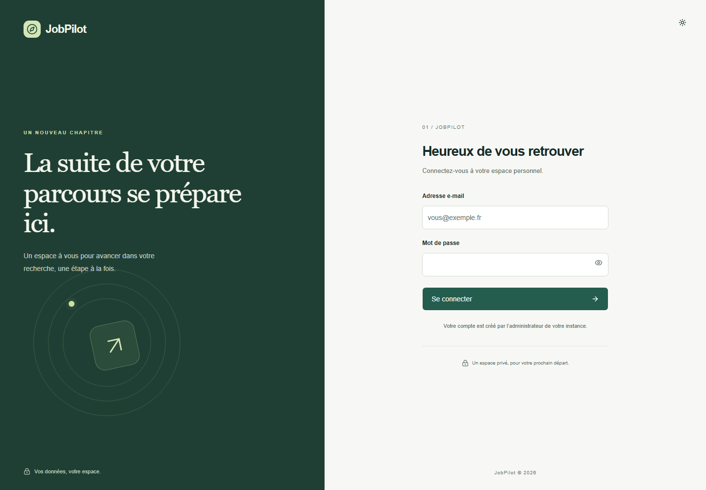
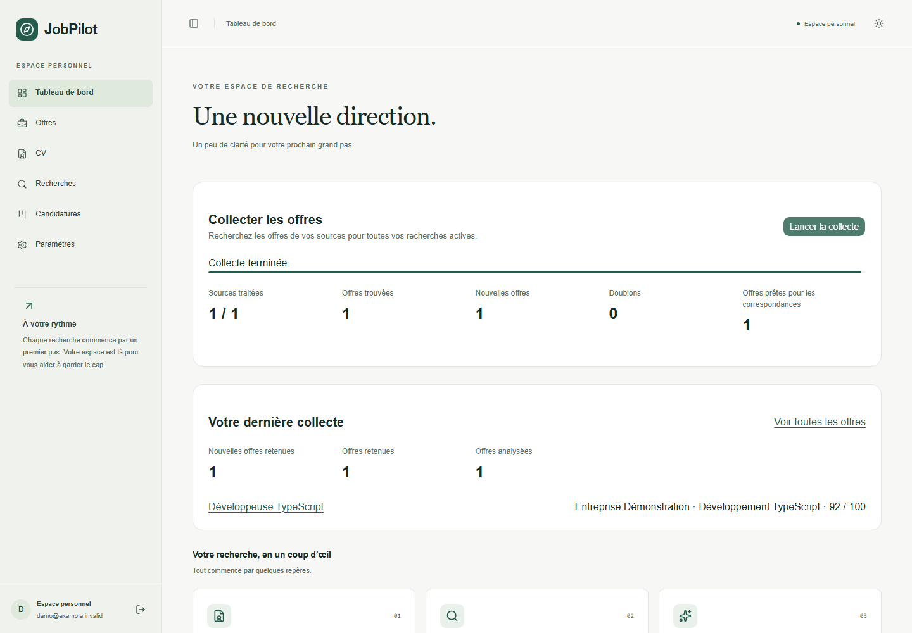
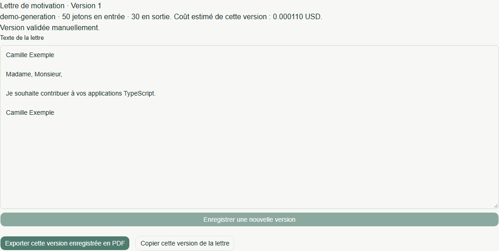
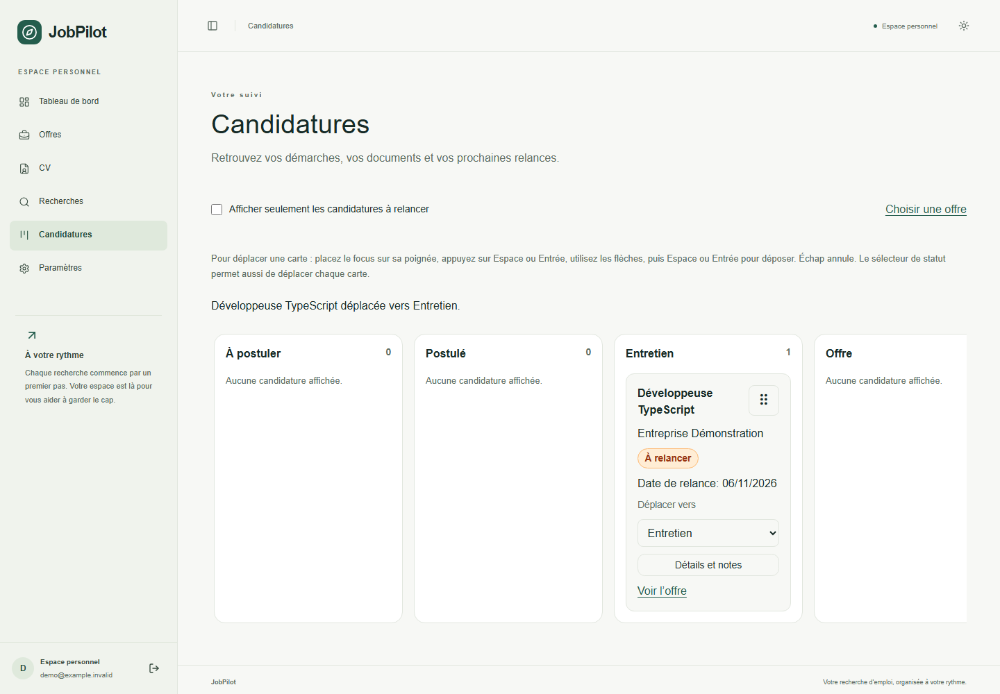
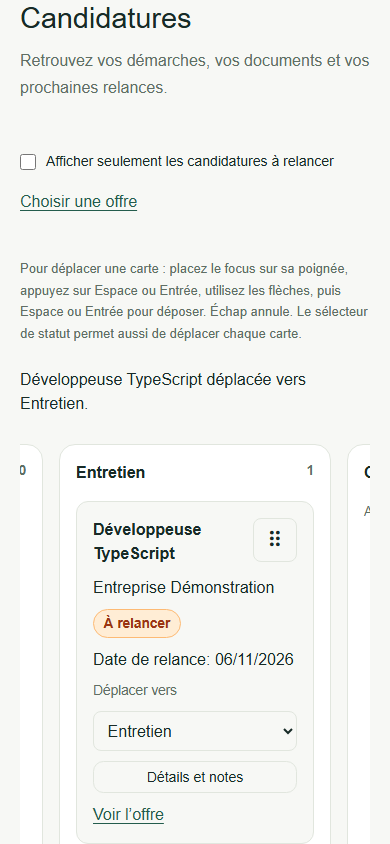
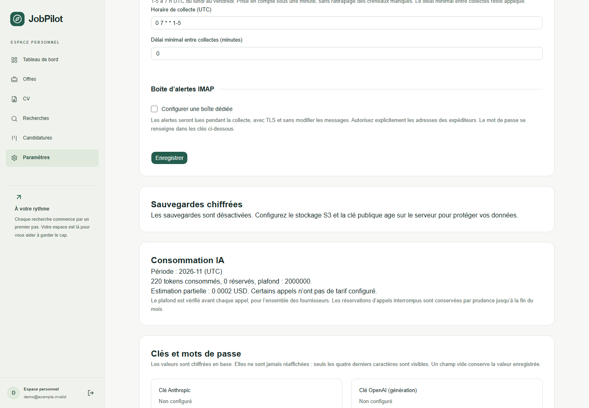

# User guide

JobPilot helps you review authorized job offers and prepare application drafts. It never sends applications or recruiter emails for you. Screenshots below use a fictional account, resume and employer; the demo models are simulated and are not provider model recommendations.

## First login and setup

The instance administrator creates your account with the documented account CLI. Public registration is disabled. Sign in at **Connexion**, then open **CV** to create a master resume or import a PDF. Review any imported proposal before saving it. An unavailable embedding provider does not discard your resume: its calculation state remains visible and can be retried.



In **Paramètres**, select the generation, scoring and embedding providers/models. API keys and the IMAP password are write-only and encrypted on the server. Ollama supports local processing when the configured endpoint runs locally. Remote providers receive the useful resume/offer content needed for their operation. Configure pricing if you want cost estimates, and keep the monthly token limit within your budget.

Add ATS companies for Greenhouse, Lever or Ashby, or configure your Adzuna credentials. For personal email alerts, use a dedicated mailbox, authorized senders and a TLS IMAP server. JobPilot reads alerts without changing or deleting mailbox messages. France Travail is deliberately unavailable in this release.

Create a **Recherche** linked to a master resume. Choose titles, filters and authorized sources, then activate it. Archived resumes and inactive searches are not collected.

## Daily review

On **Tableau de bord**, select **Lancer la collecte**. The report shows processed sources, new offers, duplicates and errors. A source failure does not discard results from successful sources. Wait for collection/scoring to complete, then follow a result or open **Offres**.



Filter offers by search, source, score, date and status. Open a result to read its source, description, score explanation and caveats. Unknown contract, salary or distance data is retained with a caveat rather than silently guessed. Mark a result interesting, ignored or applied. Ignored offers stay ignored across known duplicates.

## Tailored documents

From an offer, choose a master resume, tone, length and language, then select **Générer CV et lettre**. The master is unchanged. Each saved variant has a version, model, measured token usage and a cost estimate when pricing is configured.

Read both documents. Additions and reformulations are flagged for review. Correct unsupported facts and explicitly validate only what you have compared with the master. PDF export and letter copying remain blocked until review is satisfied. Changing the master invalidates prior approval for export; version history remains available.



## Application tracking

Select **Ajouter au suivi** to create a draft, or **Marquer comme postulée** after sending the application yourself. In **Candidatures**, move through **À postuler → Postulé → Entretien → Offre → Refus**. Mouse dragging, keyboard dragging and the status selector are all available.

To drag without a mouse, focus the card handle, press Space or Enter, move with arrows, then press Space/Enter to drop or Escape to cancel. **Détails et notes** saves your application date, follow-up date, notes and the exact reviewed resume/letter versions used. A due date displays **À relancer**; no email is sent. Terminal offer/rejection stages do not display overdue reminders. For a long history, load older cards to include them in the displayed counts/filter.





## Scheduling and backups

In **Paramètres → Collecte planifiée**, an empty field disables scheduling. Enter a numeric five-field UTC cron, such as `0 7 * * 1-5` for weekdays at 07:00 UTC (08:00 Paris winter time, 09:00 summer time). Changes take effect within one minute; missed time slots are not replayed. The configured minimum interval and single-active-collection rule still apply. Disable the field to stop future scheduled collections.

The same page shows the backup state. Backups are disabled until the administrator configures an S3-compatible bucket and an age public recipient. The private age identity and database encryption keys must be kept separately. An upload success does not prove recoverability: administrators should regularly follow [the tested restoration guide](operations-and-recovery.md). Old untouched offers are purged after the configured retention period; actions, applications and generated documents preserve their offers.



Export your own data or delete your account through the account controls. Account deletion clears live owned data; historical encrypted backups expire according to the storage lifecycle configured by the administrator. Report vulnerabilities privately using [the security policy](../SECURITY.md).

## Verification and demonstration

From a configured development checkout with Docker running:

```sh
pnpm install --frozen-lockfile
pnpm db:generate
pnpm --filter @jobpilot/web build
pnpm exec playwright install chromium
pnpm test:e2e
```

Ports 3000 and 3001 must be free. The browser fixture creates isolated PostgreSQL/Valkey services, a real authenticated API and real collection/scoring workers. Only source HTTP responses and AI outputs are simulated. It never uses the normal database or provider credentials. Its temporary credentials and traces are under ignored `.pnpm-store/`; services and credentials are cleaned after the run. The test regenerates these synthetic screenshots after verifying login, collection, scoring, generation/review/PDF, unchanged master data, application documents, keyboard movement, mobile layout, scheduling and logout. CI runs the same test using the installed Chromium version.

The root test command runs workspace suites sequentially to bound Docker/database resource contention on development machines and CI. Each integration suite still uses real disposable services.
